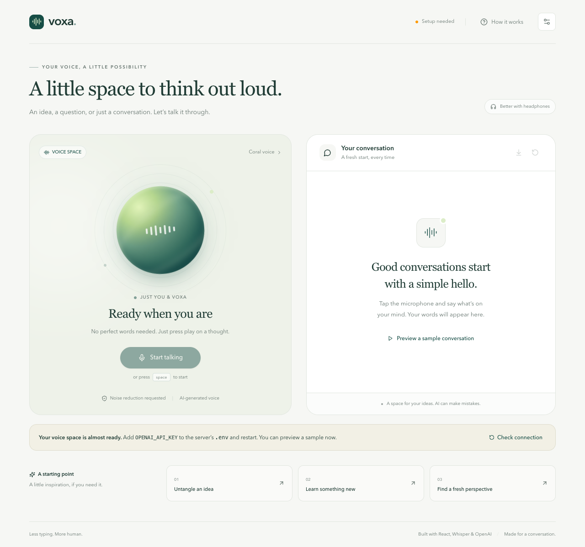
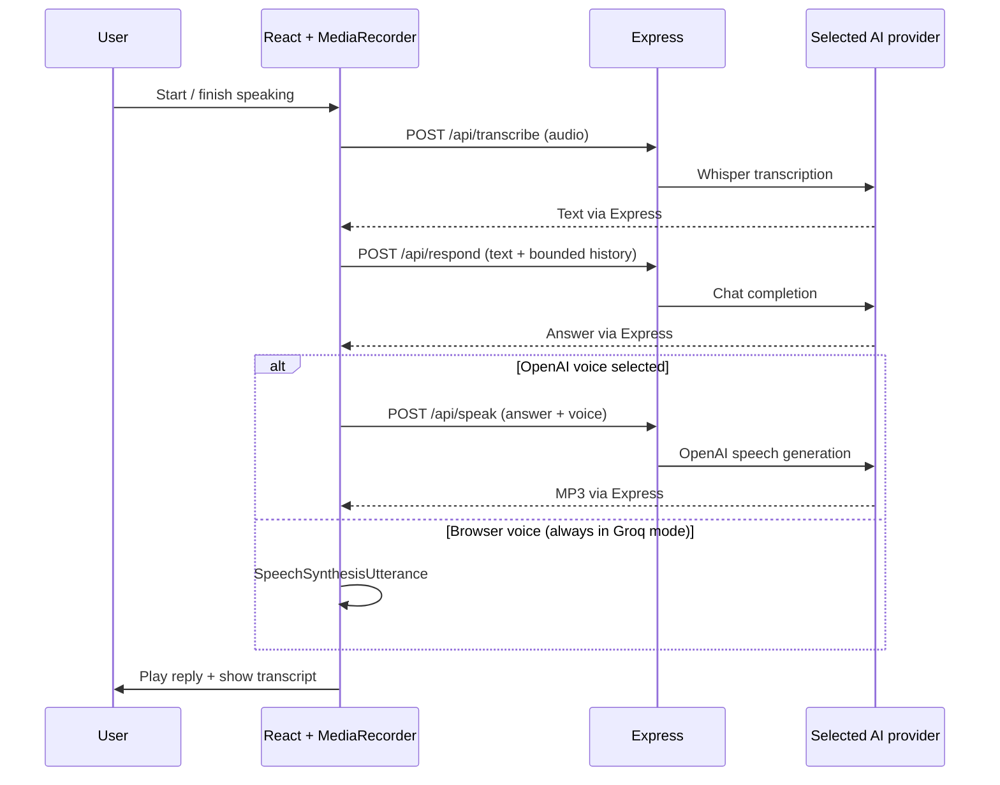

# Voxa — a little space to think out loud

A voice-to-voice AI companion built with **React, TypeScript, Tailwind CSS, Node.js, and Express**, with **OpenAI or Groq** as the AI provider. Press the microphone, say what is on your mind, and hear a contextual reply. No typing required.



## Run locally

Requirements: **Node.js 22.12+**, npm, a current browser, and a Groq or OpenAI API key with access to the configured models.

```bash
npm ci
cp .env.example .env
```

The example configuration selects **Groq**. Create a key at [Groq API Keys](https://console.groq.com/keys) and set `GROQ_API_KEY` in `.env`, then:

```bash
npm run dev
```

Open **http://127.0.0.1:5173**. The frontend proxies `/api` to Express on port 3001. Allow microphone access, click **Start talking**, speak, then click **Finish speaking**. Space also starts/stops recording when focus is outside an interactive control.

Groq mode uses hosted `whisper-large-v3-turbo` for transcription, `openai/gpt-oss-20b` for replies, and browser speech synthesis for playback. It makes no OpenAI API calls and needs no OpenAI credits. Groq offers a [free tier with usage limits](https://console.groq.com/docs/rate-limits); account/model availability and quotas are controlled by Groq. Browser voice quality and availability depend on your browser and device.

For the assignment's original **OpenAI Whisper + ChatGPT API** flow, set `AI_PROVIDER=openai` and `OPENAI_API_KEY` in `.env`. This retains `whisper-1`, `gpt-4.1-mini`, and optional OpenAI TTS. OpenAI API billing is separate from Groq. Groq mode is an alternative for development and testing; it does not claim to call the ChatGPT API.

The interface works without a key, displays the selected provider's setup state, and offers an explicitly labeled sample conversation. The sample is static and uses browser speech for replay; it does not simulate a successful provider request. Live recording is enabled after server configuration is detected. Restart the server after editing `.env`, then click **Check connection**. Never paste credentials into chat or commit `.env`.

## Features

- MediaRecorder capture with runtime WebM/MP4/OGG format negotiation.
- Whisper transcription, contextual GPT responses, and OpenAI speech synthesis.
- Optional Groq mode with automatic browser voice and no fallback to paid OpenAI calls.
- Optional browser speech synthesis, three OpenAI voices, replay, and interruption.
- Live input level display, echo cancellation, automatic gain, and noise suppression requests.
- A 60-second recording limit and a basic near-silence gate to avoid sending empty recordings.
- Explicit recording, transcription, thinking, synthesis, playback, and error states.
- Retries resume the failed stage without duplicating earlier work or transcript messages.
- Reset cancels active requests, discards late results, stops playback, releases the microphone, and clears conversation history.
- In-memory history by default; opt-in localStorage persistence and plain-text export.
- Responsive Tailwind interface, keyboard controls, live status announcements, native accessible dialogs, and reduced-motion support.
- Typed validation, bounded uploads and context, rate limiting, request IDs, provider deadlines, and sanitized errors.

## How it works



Browser voice skips `/api/speak` and reads the response with `SpeechSynthesisUtterance`. All live transcription and response generation still use the backend.

### Structure

```text
client/src/
  components/       Voice workspace visual, transcript, settings
  hooks/            Voice lifecycle and conversation orchestration
  lib/              HTTP client, recorder, persistence, export
server/src/
  app.ts            HTTP boundaries, validation, cancellation, errors
  provider.ts       Explicit OpenAI/Groq selection behind a testable interface
  index.ts          Configuration, startup, graceful shutdown
shared/
  contracts.ts      Runtime schemas, shared types, limits
tests/e2e/          Browser tests using a synthetic microphone
```

### Design decisions

**A small, explicit pipeline.** The three HTTP endpoints follow the assignment and make each stage independently testable. Full-duplex realtime streaming would be a different architecture; the current app waits for a completed recording and response.

**TypeScript across the boundary.** Zod validates request data at runtime; shared contracts keep frontend and backend limits aligned. The API key exists only on the server and is never exposed through a `VITE_` variable.

**Browser-owned context.** Each response includes up to 20 preceding messages. The transcript retains up to 100 messages; older context is omitted rather than silently promising unlimited memory. No database or global server conversation object is needed, and separate browsers do not share conversation state.

**Lifecycle safety.** AbortControllers cancel HTTP requests. A generation counter prevents delayed microphone permissions or responses from reviving a canceled conversation. Cleanup stops tracks, closes audio contexts, cancels timers, and revokes audio object URLs. Express forwards client disconnects to the provider and enforces a deadline.

**Deliberate retries.** Provider auto-retries are disabled to avoid hidden latency and duplicate charges. The user can retry the failed transcription, response, or speech stage. The most recent generated audio is cached in memory for replay; replaying an older answer or changing the OpenAI voice can generate a new paid speech request.

**Browser noise control.** The app requests `echoCancellation`, `noiseSuppression`, and `autoGainControl`. Actual support and quality depend on the browser/device. The amplitude gate detects near-silence; it is not a speech classifier and cannot reliably distinguish speech from background sound. Headphones improve echo isolation.

## API

`GET /api/health` returns `{ "status": "ok", "configured": true, "provider": "groq", "speechOutput": "browser" }` in configured Groq mode. OpenAI mode reports `"provider": "openai"` and `"speechOutput": "openai"`. This is a configuration check, not proof that the selected key, billing, or model permissions are valid. The browser uses the advertised speech mode automatically.

`POST /api/transcribe` accepts multipart form data with one `audio` file, up to 10 MB. Supported MIME types: `audio/webm`, `audio/mp4`, `audio/wav`, `audio/mpeg`, `audio/ogg`. Returns `{ "text": "..." }`.

`POST /api/respond` accepts:

```json
{
  "text": "What should I explore next?",
  "history": [
    { "role": "user", "content": "I enjoy astronomy." },
    { "role": "assistant", "content": "What interests you about it?" }
  ]
}
```

The current input is separate from history. Only `user` and `assistant` roles are accepted. Each text is limited to 4,000 characters; history is limited to 20 messages. Returns `{ "text": "..." }`.

`POST /api/speak` accepts `{ "text": "...", "voice": "coral" }` and returns `audio/mpeg` in OpenAI mode. Voices: `coral`, `alloy`, `sage`. Groq mode uses browser speech instead; direct requests to this endpoint return `409 BROWSER_SPEECH_ONLY` when configured, without contacting another provider.

Errors use `{ "error": { "code": "...", "message": "...", "requestId": "..." } }`. The same request ID is returned in `X-Request-Id`. HTTP errors include 400 for invalid input, 413 for oversized bodies, 415 for unsupported audio, 422 for empty transcription, 429 for rate limits, 502 for provider failures, 503 for missing configuration, and 504 for the request deadline.

## Configuration

- `AI_PROVIDER`: `groq` or `openai`. The example selects Groq; omission preserves OpenAI behavior for existing setups. Invalid values stop startup.
- `GROQ_API_KEY`: server-only credential; required in Groq mode.
- `GROQ_CHAT_MODEL`: defaults to `openai/gpt-oss-20b`. GPT-OSS uses low reasoning effort, omits reasoning from the response, and reserves 2,048 completion tokens for reasoning plus the final spoken answer.
- `GROQ_TRANSCRIPTION_MODEL`: defaults to `whisper-large-v3-turbo`.
- `OPENAI_API_KEY`: server-only credential; required in OpenAI mode only.
- `CHAT_MODEL`: defaults to `gpt-4.1-mini`, using Chat Completions with `store: false`.
- `TRANSCRIPTION_MODEL`: defaults to the assignment's `whisper-1`.
- `TTS_MODEL`: defaults to `gpt-4o-mini-tts`.
- `PORT`: defaults to `3001`.
- `HOST`: defaults to `127.0.0.1`.
- `APP_ORIGIN`: exact browser origin, required in production.
- `NODE_ENV`: set to `production` to serve the built frontend from Express.

Model overrides must support the adapter's endpoint and parameters. Groq model settings are separate from OpenAI settings, so switching providers does not reuse incompatible model IDs. Selection is explicit: missing credentials or provider failures never trigger a fallback to another service. The existing OpenAI SDK talks to Groq's documented compatible endpoint; `store: false` is sent only to OpenAI. No new SDK dependency is needed.

`.env` is ignored by Git and Docker. The server buffers recordings only in memory and does not log audio, transcripts, credentials, or raw provider errors. The selected provider (Groq or OpenAI) processes submitted audio and conversation context; its own data policies apply. Browser voice may use the operating system/browser vendor's speech service.

## Verification

```bash
npm run check          # TypeScript, API tests, production build
npm run format:check   # Consistent source formatting
npx playwright install chromium
npm run test:e2e       # Browser suite; no API key required
```

If Google Chrome is already installed, `PLAYWRIGHT_CHANNEL=chrome npm run test:e2e` uses it instead of downloading Chromium. On Linux CI, use `npx playwright install --with-deps chromium`.

API tests exercise multipart uploads, context forwarding, validation, error redaction, request IDs, timeouts, origins, and rate limits. Provider tests use the real SDK with a stubbed network transport to verify endpoint/key isolation, model selection, serialized uploads, and the absence of OpenAI speech calls in Groq mode. Browser tests run a real MediaRecorder against Chromium's synthetic audio device and stub `/api` responses. They cover both voice modes, retries, reset races, microphone permission failures, persistence, silence, and autoplay failure. Groq browser-speech tests stub `speechSynthesis`; they prove routing and lifecycle behavior, not audible voice quality. They do not test real provider transcription/replies, physical microphones, or mobile Safari. Screenshot assets in `docs/` show the configuration-required state and a labeled sample conversation.

GitHub Actions runs formatting, type checks, API tests, production build, and Chromium tests without any API secrets. No remote CI result is implied until the repository has been pushed and the workflow completes.

### Manual acceptance check with a real key

1. Record a short introduction, verify its transcript, and hear the reply.
2. Ask a follow-up referring to the introduction; verify that context is preserved.
3. Try quiet speech, a noisy room, and headphones; inspect transcription quality.
4. Deny microphone access, then grant it and retry.
5. Reset during recording and while waiting for a response; verify the old turn does not reappear.
6. Test OpenAI voice and browser voice, replay, and interruption.
7. Enable browser history, reload, then reset and reload again.
8. Try Chrome/Edge desktop and Safari on a physical iPhone over HTTPS.

## Production build

```bash
npm run build
NODE_ENV=production APP_ORIGIN=http://localhost:3001 npm start
```

Open **http://localhost:3001**. Production serves the React build and API from the same Express origin. When using a host/container, set `HOST=0.0.0.0` and the exact HTTPS `APP_ORIGIN`.

Optional Docker setup:

```bash
docker build -t voxa .
docker run --rm -p 127.0.0.1:3001:3001 --env-file .env \
  -e NODE_ENV=production -e HOST=0.0.0.0 \
  -e APP_ORIGIN=http://localhost:3001 voxa
```

The Dockerfile is provided as a deployment convenience; it must be built and validated in your Docker environment.

### Deployment boundaries

This submission runs locally without user accounts. Rate limiting (30 API calls per minute per IP), upload limits, origin checks, and secure response headers are implemented, but **origin checks are not authentication**. Add authentication and per-user quotas before exposing paid AI endpoints publicly. The in-memory rate limiter is per process; use a shared store for multiple instances. Configure a trusted reverse proxy deliberately rather than blindly trusting forwarded IP headers. Use HTTPS for microphone access outside localhost, and set provider spending limits appropriate to the demo.

## Troubleshooting

- **Setup needed:** add the server API key, restart, and click Check connection.
- **Groq setup:** set `AI_PROVIDER=groq` and `GROQ_API_KEY`. An OpenAI key cannot authenticate with Groq. Browser voice is selected automatically; its selector is locked in this mode.
- **Groq limit reached:** wait for the account's quota to reset and check [Groq limits](https://console.groq.com/settings/limits). The app does not silently switch to a paid service.
- **Microphone unavailable:** use HTTPS/localhost, grant browser access, and check the selected system input device.
- **No speech detected:** speak closer to the microphone; ensure the device is not muted. Very quiet speech can fail the amplitude gate.
- **Reply is visible but silent:** click Replay. If autoplay is blocked or the device cannot play it, select Browser voice. Device voice availability varies.
- **Provider error:** verify API key validity, billing, and access to the configured models. The browser intentionally does not receive raw provider errors.
- **Port already used:** stop the other process or update `PORT` and the proxy target in `vite.config.ts` together.

## References

- [Groq OpenAI compatibility](https://console.groq.com/docs/openai)
- [Groq speech-to-text guide](https://console.groq.com/docs/speech-to-text)
- [Groq supported models](https://console.groq.com/docs/models)
- [OpenAI speech-to-text guide](https://developers.openai.com/api/docs/guides/speech-to-text)
- [OpenAI text-to-speech guide](https://developers.openai.com/api/docs/guides/text-to-speech)
- [OpenAI TypeScript SDK](https://developers.openai.com/api/reference/typescript)
- [MediaRecorder API](https://developer.mozilla.org/en-US/docs/Web/API/MediaRecorder)

## Potential next steps

Measure real provider latency and speech accuracy before changing the architecture. If faster turn-taking is needed, introduce streamed text/audio or a realtime transport. Other purposeful additions would be authenticated sessions, per-user budgets, stronger voice activity detection, and a broader physical-device test matrix.
